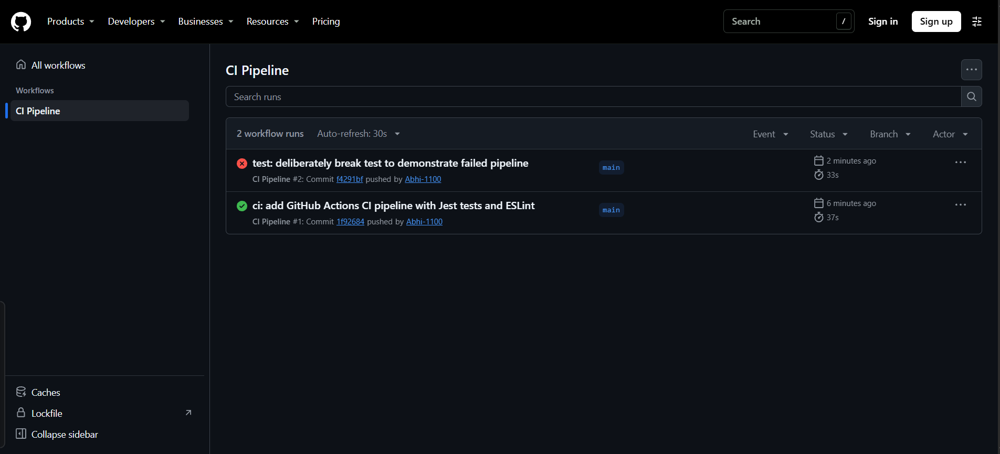
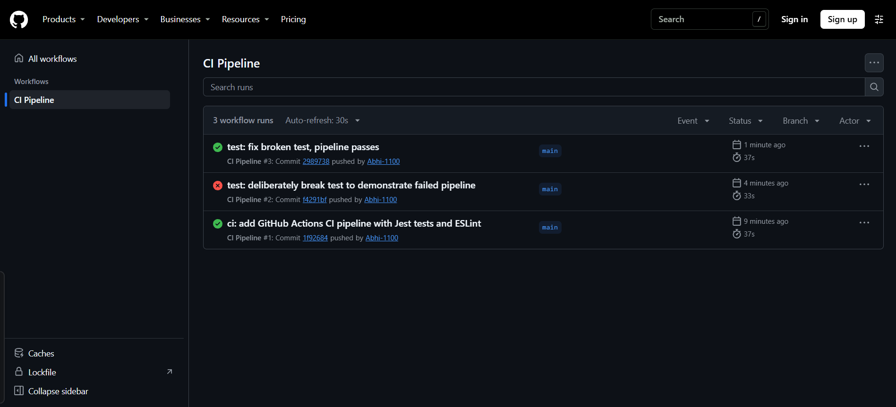

# Task Manager API

[](https://github.com/Abhi-1100/Advanced-Web-Development/actions/workflows/ci.yml)

A simple RESTful API built with Node.js and Express for managing tasks.

The API enables CORS for the React dev server at `http://localhost:5173`.

## Endpoints

- POST /register (public)
- POST /login (public)
- GET /me (Bearer token required)
- GET /tasks (Bearer token required)
- POST /tasks (Bearer token required)
- PUT /tasks/:id (Bearer token required)
- DELETE /tasks/:id (Bearer token required)

## Run locally

```bash
npm install
npm start
```

The server runs on port 5000 by default.

## Run tests and lint

```bash
npm test
npm run lint
```

Jest uses Supertest to exercise the Express app without opening a network port.
The task model is mocked for `GET /tasks`, so this test does not need a live
MongoDB instance. The second test checks that a task without a title receives
HTTP 400.

The app is exported from `app.js`; `server.js` is responsible for connecting
to MongoDB and listening on the configured port. The committed ESLint setup
(`.eslintrc.json` and the `lint` script) is reproducible without the
interactive `npm init @eslint/config` wizard.
For a fresh project that does not use this committed configuration, the
interactive setup command is `npm init @eslint/config`.

## CI pipeline

The `.github/workflows/ci.yml` workflow runs on pushes to `main`. `actions/checkout@v4`
checks out the repository, and `actions/setup-node@v4` selects Node.js 18. The
`lint` job installs packages in `Practical 4` and runs ESLint. The
`build-and-test` job depends on `lint` (`needs: lint`), then installs packages
and runs Jest. Each `working-directory` points to this practical's package
folder because its `package.json` is not at the repository root.
The checked-out repository currently has `master` and `practical` branches,
but no `main` branch. With the assignment-required `main` filter, push or merge
the demo commits to `main`; otherwise change the workflow branch filter to your
actual target branch.

To run the same checks locally:

```bash
cd "Practical 4"
npm install
npm run lint
npm test
```

To run on pull requests targeting `main` instead of pushes, replace the
workflow's `push` trigger with:

```yaml
on:
  pull_request:
    branches: [main]
```

## CI demonstration screenshots

Save the failed and successful run screenshots in `docs/screenshots/` using
these filenames after capturing them from GitHub Actions:





## Practical 7 authentication

`JWT_SECRET` is loaded from `.env`; `.env` is excluded by `.gitignore` and must
never be committed. Use `.env.example` as a template for another machine.

Passwords are hashed with bcrypt using 10 salt rounds. Login uses
`bcrypt.compare`, then returns a JWT that expires after one hour. The auth
middleware verifies the Bearer token before any task handler runs, while task
validation rejects malformed input before it reaches MongoDB.

### Postman flow

1. `POST http://localhost:5000/register` with JSON `{ "email": "test@example.com", "password": "secret123" }` and confirm `201`.
2. `POST http://localhost:5000/login` with the same JSON and copy the returned `token`.
3. Call `GET http://localhost:5000/tasks` without an Authorization header and confirm `401`.
4. Call the same endpoint with `Authorization: Bearer <token>` and confirm `200`.
5. Call `GET http://localhost:5000/me` with the token and confirm the user is returned without a password.
6. Call `POST /tasks` with the token but without `title` and confirm `400`.
7. Change one character in the token and retry; confirm `401 Invalid or expired token`.
8. To test expiry without waiting, create a short-lived JWT only in a local test script or use a token whose `exp` value has passed; confirm `401` and that the server stays running.
